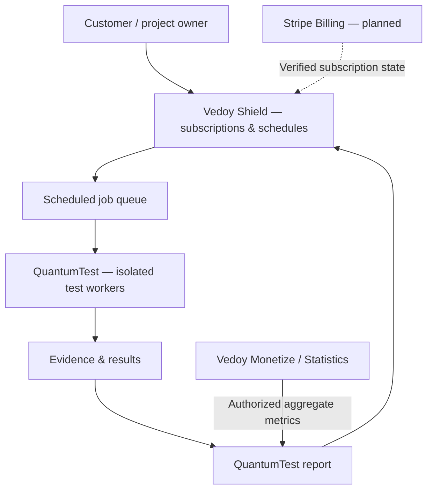

<div align="center">

# QuantumTest

### Test what matters. Prove what works.

**AI-assisted web application quality assurance, security assessment and evidence-backed product insights.**

By **Vedoy Studio** · Part of the Vedoy ecosystem

[Overview](#overview) · [Capabilities](#capabilities) · [Architecture](#architecture) · [Security](#security-and-privacy) · [Documentation](#documentation) · [Roadmap](#roadmap)

</div>

> [!IMPORTANT]
> **Early development / integration preview.** This repository is not a production-ready scanning service. Features marked **Planned** are product direction, not shipped capabilities. The current branch contains a Shield subscription scaffold, a proposed Monetize Statistics adapter, and technical specifications. No production scanning, Stripe billing, or live analytics integration has been verified.

## Overview

QuantumTest is an emerging web application testing platform from Vedoy Studio. Its goal is to help developers and businesses answer three questions:

1. **Does it work?** Test critical journeys such as registration, login, account settings, checkout and account deletion.
2. **Is it trustworthy?** Examine observable security configuration, TLS, accessibility and post-quantum migration readiness.
3. **What should we improve next?** Combine reproducible findings with authorized product analytics and transparent business scenarios.

QuantumTest is designed to power one-time assessments and recurring checks managed by **Vedoy Shield**. Optional traffic and conversion insights are intended to come from **Vedoy Monetize → Statistics**—not from a competing analytics store.

## Product principles

| Principle | Commitment |
| --- | --- |
| Evidence before claims | Every finding should include provenance, time, environment and reproduction guidance. |
| Privacy by default | Technical testing does not require end-user behavioral tracking; optional analytics remains separate. |
| Safe by design | Authorized targets only; passive checks by default; no unapproved intrusive testing. |
| Human-centered QA | AI personas may simulate journeys but must never be presented as real human research. |
| Honest uncertainty | Observed metrics, simulated behavior and modeled estimates are clearly differentiated. |
| Modular integration | QuantumTest tests, Shield schedules, Monetize supplies permissioned statistics. |

## Capabilities

| Capability | Status | Description |
| --- | --- | --- |
| Monthly scan scheduling | **Scaffold** | Database model, scheduling logic and job-claim function on the feature branch. |
| Scan job history | **Scaffold** | Tenant-readable job and result records; worker lifecycle requires hardening. |
| Notification records | **Scaffold** | Database records; actual delivery is not implemented. |
| TLS configuration checks | **Planned** | Certificate and transport configuration assessment. |
| Post-quantum readiness | **Planned** | Review observable protocol and cryptographic migration signals. |
| Passive web security checks | **Planned** | Security headers and authorized passive scanner findings. |
| Browser journey testing | **Planned** | Reproducible Playwright/Chromium journeys using designated test accounts. |
| Performance and accessibility | **Planned** | Lighthouse, Core Web Vitals context and axe-core checks. |
| AI-simulated personas | **Planned** | Labeled simulations with traceable scenarios and limitations. |
| Monetize Statistics | **Adapter scaffold** | Read-only server adapter; real endpoint and contract remain unverified. |
| Stripe subscriptions | **Planned** | Secure Checkout, signed webhooks and entitlement enforcement. |
| Consolidated reports | **Specification** | Technical findings, authorized metrics, scenarios and methodology. |
| IBM Quantum experiments | **Research concept** | Optional demonstration only; not a security certification or default test. |

**Status terminology:** *Scaffold* means code structure exists, not that it has passed end-to-end tests; *Specification* means documented design; *Planned* means not implemented.

## Architecture



### Responsibility boundaries

- **QuantumTest:** scanning adapters, reproducible evidence, severity and reporting.
- **Vedoy Shield:** customer entitlements, scheduling, queue orchestration, history and alert policy.
- **Vedoy Monetize:** consent management, optional Statistics collection and aggregated reporting; Advertize and Rewards must not be prerequisites.
- **Stripe:** subscription billing and payment lifecycle; never the source of scan findings.

The proposed Monetize API is **not verified** against a running implementation. The adapter intentionally fails closed for untrusted origins and unavailable data.

## Repository layout

```text
README.md
docs/
  SHIELD_INTEGRATION.md
  QUANTUMTEST_INSIGHTS.md
  VEDOY_STATISTICS_PRIVACY.md
  VEDOY_MONETIZE_INTEGRATION.md
  MONETIZE_ADAPTER_SETUP.md
src/
  shield/
    scheduler.ts
    runner.ts
  integrations/
    vedoy-monetize.ts
supabase/
  migrations/
    20261108_shield_scans.sql
```

The paths above describe the feature branch. This is not yet a standalone runnable application: there is no verified package setup, production worker, deployment or complete test suite.

## Development and integration

### Prerequisites

A production implementation will need Node.js/TypeScript, an isolated scanner runtime, a configured Supabase/PostgreSQL backend, and (for paid subscriptions) Stripe credentials. **No copy-and-paste production quickstart is available yet.**

### Shield scheduling

The draft migration defines subscriptions, scan jobs and notification records, with owner-scoped read policies. The TypeScript scaffold provides monthly date calculation, due-job enqueueing and a claimed-job worker boundary.

Before deployment, implement atomic scheduling, lease recovery, safe target validation, real scanner adapters, notification delivery and integration tests. Never expose a Supabase service-role key in client code.

See [Shield integration guide](docs/SHIELD_INTEGRATION.md).

### Monetize Statistics

A server-side adapter is provided at [`src/integrations/vedoy-monetize.ts`](src/integrations/vedoy-monetize.ts). It uses an explicit HTTPS-origin allowlist, server-only bearer credentials, an eight-second timeout and optional metrics. It **does not** create tracking events or store personal analytics.

The proposed `/v1/statistics/projects/{projectId}/summary` contract must be checked against the actual Monetize service before enabling it. Missing analytics is **unknown**, never zero.

See [Monetize adapter setup](docs/MONETIZE_ADAPTER_SETUP.md) and [integration contract](docs/VEDOY_MONETIZE_INTEGRATION.md).

## Security and privacy

> [!WARNING]
> Only scan assets you own or are explicitly authorized to test. Do not run active scans, authentication attacks or destructive tests against third-party systems without separate authorization.

The production design requires:

- Target ownership verification and strict public-network egress controls, including DNS rebinding and SSRF defenses.
- Isolated workers, bounded concurrency, execution limits, credential redaction and short retention.
- Authenticated tenant boundaries and least-privilege service credentials.
- Passive-only security checks by default, with explicit authorization for anything intrusive.
- Verified Stripe webhook signatures, idempotency and fail-closed entitlements.
- Optional behavioral analytics only under an appropriate legal basis and consent where required.
- Clear separation of **anonymized aggregates**, **pseudonymous personal data**, and **ephemeral processing**.
- Responsible disclosure for discovered vulnerabilities.

**Post-quantum readiness is not a guarantee of quantum-resistant security.** Observable TLS and algorithm information cannot prove an application's entire cryptographic architecture is safe.

## Reporting and interpretation

A proposed QuantumTest report includes an executive summary, reproducible findings, accessibility and performance observations, TLS/PQC readiness, historical changes, source provenance and prioritized remediation.

Commercial impact estimates must show the formula, baseline, assumptions and sensitivity range. A simulated 10% relative improvement in a 2% conversion rate is **2.2%**, not 12%; it is a scenario, not measured lift.

See [QuantumTest Insights specification](docs/QUANTUMTEST_INSIGHTS.md).

## Roadmap

- **Phase 1 — Foundations:** harden database migration, queue leasing, target authorization and worker isolation.
- **Phase 2 — Verified tests:** implement TLS/PQC/passive security adapters with reproducible fixtures and automated tests.
- **Phase 3 — Subscriptions:** implement Stripe Checkout, webhook deduplication, entitlements and notifications.
- **Phase 4 — Insights:** verify Monetize Statistics APIs, consent scopes, aggregation and report generation.
- **Phase 5 — Expansion:** browser journeys, performance, accessibility, calibrated AI-persona experiments and optional quantum research.

This roadmap describes intended development, not committed release dates.

## Documentation

| Guide | Purpose |
| --- | --- |
| [Shield integration](docs/SHIELD_INTEGRATION.md) | Scheduling, billing boundaries and production blockers |
| [Monetize adapter setup](docs/MONETIZE_ADAPTER_SETUP.md) | Connecting the guarded read-only Statistics adapter |
| [Monetize integration contract](docs/VEDOY_MONETIZE_INTEGRATION.md) | Product boundaries and proposed API |
| [Privacy-first Statistics](docs/VEDOY_STATISTICS_PRIVACY.md) | Collection modes, consent and data minimization |
| [Insights and reporting](docs/QUANTUMTEST_INSIGHTS.md) | Metrics, estimation formulas and evidence standards |

## Contributing and project status

QuantumTest is currently an early-stage Vedoy Studio project. Before proposing production features, include threat-model considerations, test fixtures, clear acceptance criteria and documentation of what is actually verified. No public contribution process, support SLA or security contact has been published yet.

**License:** No license has been granted in this repository at the time of writing. Public visibility does not automatically grant permission to reuse, modify or redistribute the code. A license must be selected before presenting this as open source.

---

<div align="center">

**QuantumTest by Vedoy Studio**

*Build with confidence. Measure with evidence.*

[Repository](https://github.com/leandervedoy/QuantumTest) · [Vedoy Studio](https://vedoystudio.no)

</div>
